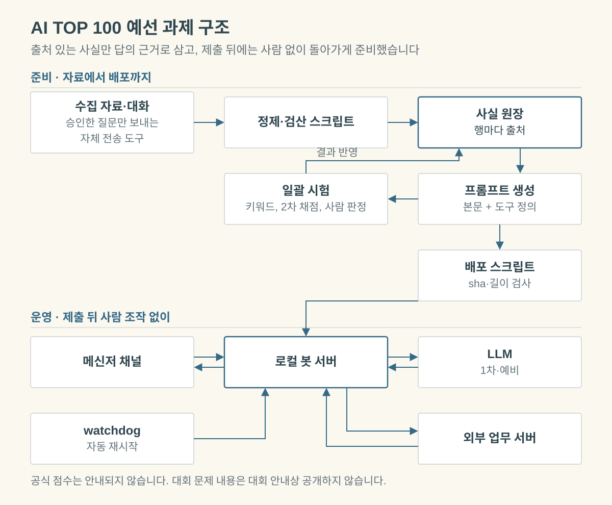

# AI TOP 100 예선 과제

**사전에 준비한 봇 위에 5시간 안에 지식과 프롬프트를 완성해 배포한 1인 참가 과제**

[포트폴리오](../README.md) / 다른 프로젝트

**제출 완료 · 결과 미정** · 2026-10-31 온라인 예선 · 상태 검토일 2026-11-02

---

> 대회 안내에 따라 문제 내용, 받은 자료, 시험 사례는 쓰지 않고 구조와 판단만 적습니다.
> 아래 수치는 모두 자체 시험 또는 자체 기록이며 공식 채점이 아닙니다. 공식 점수와 순위는 안내되지 않고 결과는 미정입니다.

## 한눈에 보기

| 항목 | 내용 |
|---|---|
| **과제** | 고객 응대 AI 에이전트를 만들어 카카오톡 채널 챗봇으로 배포하고 대회 액션 서버와 연동 |
| **형식** | 개인전. 당일 제한 시간 5시간, 봇 서버와 도구는 사전 준비 |
| **결과** | 미정. 제출을 마쳤고 결과 안내(11/4)를 기다리는 중. 공식 점수와 순위는 안내되지 않음 |
| **사용 기술** | Python · websockets · 카카오톡 봇 게이트웨이 · DeepSeek v4.1 flash(Hive) · Claude Sonnet 5.5(예비) · Windows 작업 스케줄러 · PyMuPDF · Claude Code · Codex CLI |

## 문제

자료가 대회 중에 계속 추가되고 자료끼리 어긋나는 상황에서 근거 있는 답을 내야 했고, 제출 뒤에는 수정 없이 계속 돌아야 했습니다.

## 내 역할

개인전입니다. 방향 결정, 전송 승인, 동결 예외 승인, 일부 인터뷰 직접 진행, 콘솔 설정과 봇 재시작, 제출을 맡았습니다.
자료 정제, 프롬프트, 시험, 코드 수정은 Claude Code 세션(컨트롤 1개와 하위 세션 여러 개)에 맡겼고, 독립 검증에 Codex CLI를 썼습니다.

## 핵심 설계 판단

- **사실 원장과 단일 프롬프트**: 출처 있는 확정 값만 답의 근거로 삼아 대조를 쉽게 했습니다. 검색(RAG)과 다중 에이전트를 포기해 본문 20,000자 한도에 묶였습니다.
- **도구와 직결된 사실을 도구 설명으로 이동**: 본문 한도를 넘긴 지식을 넣으려 했습니다. 블록 상한 16,000자 등의 제약으로 일부 사실과 액션 일부를 넣지 못했습니다.
- **코드 동결과 승인 예외**: 대회 전날 코드를 동결하고, 당일에는 승인한 예외 2건만 넣었습니다. 당일의 자유로운 코드 수정을 포기했습니다.
- **로컬 상주, 자동 재시작, 예비 LLM**: 제출 뒤 사람 조작이 금지라 사전 세팅으로 대비했습니다. 클라우드 배포를 포기해 노트북 한 대와 회선 하나에 의존했습니다.

## 질문 전송 자동화

Windows의 PC 카카오톡 창을 Python(ctypes)으로 제어해 질문을 붙여 넣어 보내고, 대화 목록을 복사해 원문을 저장하는 도구를 대회 당일 Claude Code 세션으로 만들어 썼습니다.

- **전송 흐름**: 승인한 질문 파일만 보냅니다. 시험 실행(dry-run)으로 창과 글을 확인하고, 대상 방 제목이 정확히 같을 때만 보내며, 답이 끝난 뒤 다음 질문으로 넘어갑니다.
- **안전장치**: 상대별 누적 상한, 중복 전송 방지 기록, STOP 파일로 즉시 중단, 입력란 불일치 시 전송 중단을 두었습니다.
- **규모**: 자동 전송 시도 539건 중 534건이 성공했고, 5건은 안전장치가 전송 전에 멈췄습니다. 대회 쪽 표시 기준 총 질문은 수동 포함 648건입니다.
- **알려진 결함**: 상태 확인 명령까지 누적 상한에 세어, 마지막 구간에 대상 1곳이 일찍 막혔습니다.

## 검증

모두 자체 시험이며 공식 채점이 아닙니다. 근거는 비공개 로컬 커밋 `933d34e`(봇 코드), `b06b4a7`(회차 기록)입니다.

| 구분 | 결과 | 읽을 때 주의 |
|---|---|---|
| 합성 단위 시험 | 264개 통과 | 가짜 액션 서버 포함, 2026-10-31 13:05 |
| 자체 질문표 (v1.1) | 사람 판정 119/124 | 봇과 같은 코드, 접수는 모의 |
| 봉인 세트 1회 (v1.2) | 사람 판정 21/24 | 실패 3건 |
| 마지막 전체 시험 (v1.3) | 사람 판정 182/184, 키워드 162/184, p95 12.4초 | 최종본보다 두 단계 앞선 버전, 2차 채점 생략. 키워드 실패 22건만 읽어 올라갈 수 있는 최댓값 |
| 독립 검증 (Codex) | 심각 1, 보통 16, 사소 2 | 심각 1건과 보통 일부만 수정 |
| 제출 뒤 봇 기록 (10/31 16:00~11/1 24:00) | 답 142건 전송 성공, 오류 0, 재시작 없음, p95 19.9초, 최대 61.3초 | 일부는 제가 확인하려고 보낸 질문이고, 심사 실행으로 보는 것은 시각 분포에 따른 추정 |

## 한계

- 봉인 세트 실패 3건은 지식 누락 1건과 판단 실패 2건이고, 전체 시험 실패 2건은 답마다 흔들린 사례입니다.
- 61.3초가 걸린 느린 답이 1건 있어 평가에 불리했을 수 있습니다.
- 실제 p95가 시험보다 느렸습니다.
- 최종 오류 수정본 2개는 재시험 없이 배포했고, 그중 1개는 실대화 확인도 못 했습니다.
- 독립 검증 지적 일부를 반영하지 못했고, 제공된 액션을 전부 등록하지 못했으며, 사진·음성은 지원하지 않습니다.
- 공식 점수를 받지 못해 자체 시험 수치가 실제 평가와 어떻게 맞는지 알 수 없습니다.

## 근거

저장소는 대회 자료가 포함되어 비공개이며 공개 링크가 없습니다. 원격 저장소도 없어 외부에서 수치를 직접 확인할 수 없습니다.

[포트폴리오 첫 화면](../README.md)
