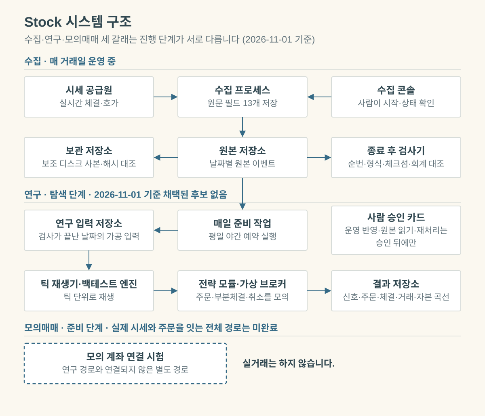
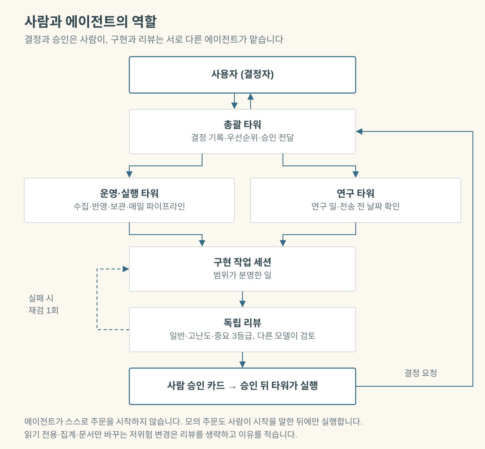
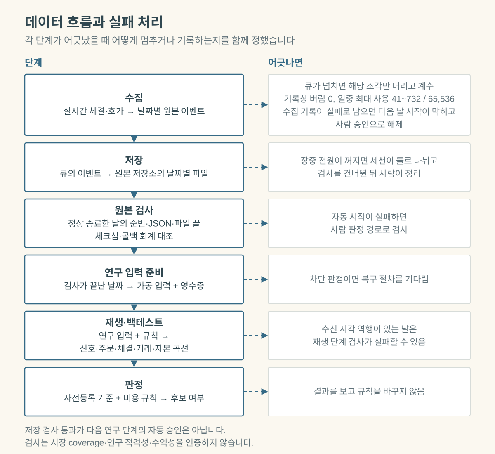
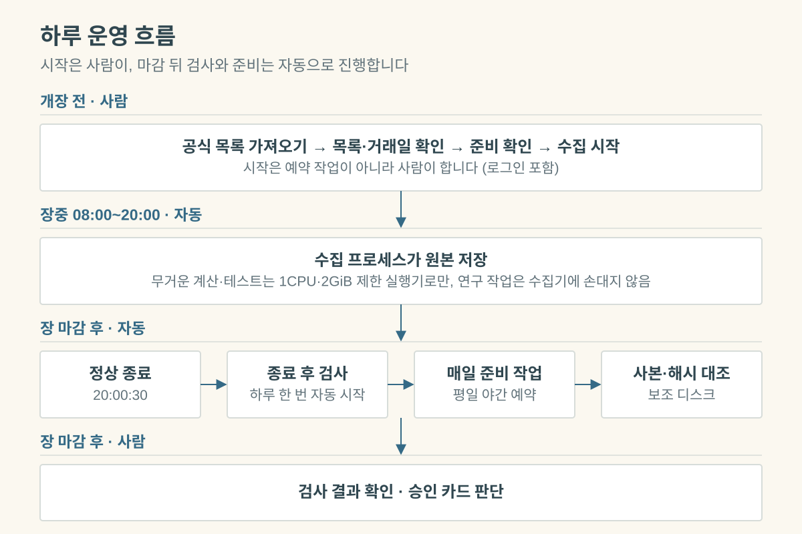
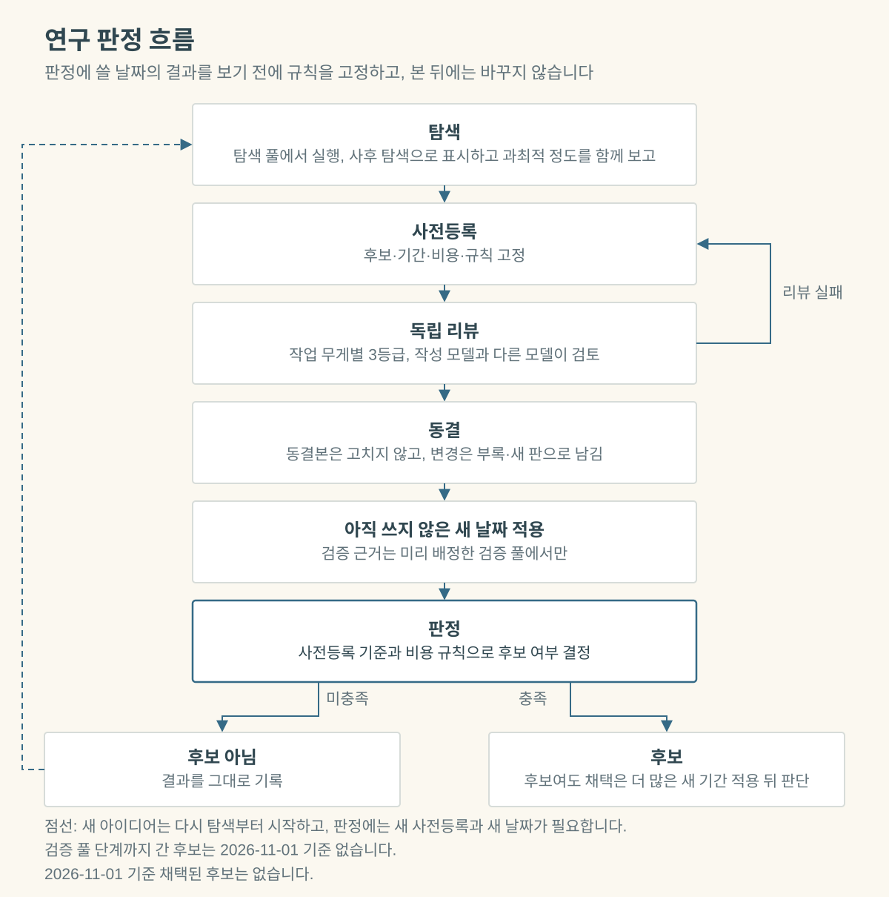

# Stock

**실시간 틱 수집 운영과 비용 반영 전략 검증 연구**

<!-- project: stock; status: in_progress; as_of: 2026-11-02 -->

[포트폴리오](../README.md) / 대표 프로젝트 01

**진행 중** · 상태 검토일 2026-11-02 · 역할 확인일 2026-09-22  
코드 규모 기준 revision: `cc86fb0bc229e9a3ac901d7dc917e5a9c8fabc1a` (2026-10-26) · 원본 저장소는 2026-10-15부터 비공개

[한눈에 보기](#한눈에-보기) · [문제](#problem) · [내 역할](#my-role) · [설계](#architecture--pipeline) · [검증](#validation) · [기술 사례](#대표-기술-사례) · [결과](#results) · [한계](#limitations) · [원본 근거](#repository--evidence)

---

> 실시간 체결·호가를 수집해 원본으로 보존하고, 그 원본을 틱 단위로 재생해 전략을 연구하며, 모의매매 연결을 개발하는 로컬 프로젝트입니다.
> 2026-11-02 기준 채택된 후보는 없고, 실거래는 하지 않습니다.

## 한눈에 보기

| 항목 | 내용 |
|---|---|
| **문제** | 초봉으로 변환하면 사라지는 이벤트 순서와 원래 관측값을 보존하고, 비용과 사전등록 규칙 아래에서 전략을 검증 |
| **수집** | 매 거래일 운영 중. KRX·NXT 08:00~20:00 체결·호가 원문. 행 수를 집계할 수 있는 11일의 합계 183,918,557행 |
| **연구** | 사전등록·독립 리뷰·동결 뒤에만 후보로 인정. 2026-11-02 기준 채택된 후보 없음 |
| **모의매매** | 합성 입력 기반 개발과 모의 서버 연결 시험 준비 단계. 실거래는 하지 않음 |
| **코드 규모** | Python 131,818줄(528개 파일, 그중 테스트 65,435줄), 테스트 함수 3,245개, 커밋 727개. 정적 집계이며 실행 통과 수가 아님 |
| **역할** | 개인 프로젝트, 문제 정의부터 설계·검증 기준·운영·최종 판단까지 |
| **사용 기술** | Python · SQLite · pytest · Streamlit |

원본 저장소는 시장 데이터 이력 때문에 비공개여서 코드 링크를 열 수 없습니다. 구조와 수치, 한계는 이 페이지에 담았습니다. 코드는 요청하시면 보여 드릴 수 있습니다(시장 데이터 제외).

## Problem
체결·호가를 초봉으로만 변환하면 구간 안의 이벤트 순서와 원래 관측값을 잃을 수 있습니다.
전략 점수보다 먼저 어떤 입력을 보존했고 어떤 검증을 통과했는지 설명할 수 있어야 합니다.
단기 전략은 거래 비용과 탐색 과정의 과적합에 쉽게 무너지므로, 비용을 넣은 기준과 판정에 쓸 날짜의 결과를 보기 전에 고정한 판정 규칙이 필요합니다.

## Context
키움 OpenAPI(Windows 32비트 OCX)로 08:00~20:00 KRX 정규장과 NXT 프리·애프터마켓 전체 세션의 주식체결·주식호가잔량을 받습니다.
원문은 SQLite에 저장하며, 원문 필드 13개를 정규 저장합니다.
호가는 체결 행에 내장되므로 체결 사이의 호가 변화는 저장되지 않습니다.
시장 데이터와 운영 기록은 Git 밖 로컬에 있고 재배포하지 않습니다. 이 사례에는 집계 수치만 씁니다.
CI 합성 데이터와 실제 시장 데이터를 같은 근거로 취급하지 않습니다.

## My Role
**개인 프로젝트 · End-to-End Project Ownership · AI-Assisted Development**
<!-- ownership: owner_confirmed; basis: owner_statement; confirmed_on: 2026-09-22 -->

원본 체결·호가를 보존하고 같은 입력으로 연구를 다시 검토할 수 있도록 문제와 목표를 정의했습니다.
수집기·운영 화면·연구 워커의 역할 분리, raw 품질 판정과 qualification·replay를 구분하는 데이터 흐름의 설계 판단을 맡았습니다(`stock-pipeline`).
성과 기준·비용 모델·사전등록 규칙을 정하고, 연구 판정과 운영 반영 여부를 결정했습니다.

기능 구현 방향과 코드 통합, 검증 전략 및 테스트·결과 검토 기준을 정하고 프로젝트 운영·우선순위·문서화와 최종 의사결정을 책임졌습니다.
SQLite sidecar와 writer 경합을 다루는 합성 회귀를 검토할 때에도 합성 테스트와 실제 시장 데이터 검증의 범위를 구분했습니다(`stock-sidecar-tests`).

ChatGPT·Claude와 Codex/Claude Code를 코드 작성·리뷰·디버깅·테스트·설계 검토·문서화·리팩터링·조사에 활용했습니다.
AI가 제안한 결과를 검토하고 채택·통합할 책임은 제가 가졌습니다. [작성자가 확인한 책임 범위](../docs/OWNERSHIP.md)는 개별 코드의 직접 타이핑이나 특정 로컬 실행자에 대한 주장과 구별합니다.

운영 반영 직전 변경과 동결하는 사전등록 최종본, 구조 결정은 가장 높은 리뷰 등급으로 다룹니다. 재검은 1회까지이고 재검도 실패하면 제가 판단합니다.
이 협업 방식은 현재 규칙이며 바뀔 수 있습니다.

## Approach
원문과 정규화 기록을 구분하고, 수집 종료의 일관성 확인과 연구 입력 합격을 분리합니다.
운영 화면·수집기·작업 워커를 별도 프로세스로 두어 실패와 제어의 책임을 나눕니다.
연구는 비용을 반영한 성과 기준을 먼저 정합니다. 탐색 풀에서 탐색한 뒤 사전등록으로 후보·기간·규칙을 고정하고, 아직 쓰지 않은 새 날짜에서 판정합니다.

## Architecture / Pipeline
각 단계가 어긋났을 때 그대로 넘어가지 않도록, 멈추거나 기록하는 방식을 단계마다 정했습니다.

수집 시작은 예약 작업이 아니라 사람이 합니다. 종료 후 검사는 2026-10-20 밤부터 자동으로 시작되고, 매일 연구 입력 준비는 2026-10-26부터 평일 야간 예약으로 실행합니다.

## Key Technical Decisions
- **원본 보존 우선**: 품질 문제가 있는 입력을 백테스트 후보로 승격하지 않습니다. 레거시 변환 자산은 삭제하지 않고 결과 계약을 분리합니다.
- **SQLite 경계**: read-only 연결이 sidecar를 전혀 만들지 않는다고 가정하지 않으며, 잠금을 풀고 쓰기 연결을 여는 in-place 정리는 경쟁 writer가 들어올 수 있어 채택하지 않았습니다.
- **원본 검사의 비용 선택**: SQLite 물리 integrity_check와 전체 파일 SHA는 비용 때문에 매일 수행하지 않고, 그 한계를 판정과 함께 기록합니다.
- **성과와 비용 기준**: 성과는 1주 정규화 가격 수익률로 재고, 현금은 제약으로 두지 않습니다. 수수료 편도 0.015%와 매도세를 빼며, 왕복 손익분기 gross 수익률은 약 0.2305%입니다.
- **사전등록과 날짜 배정**: 사전등록·동결 뒤에만 후보로 인정하고 동결본은 고치지 않으며, 변경은 부록·새 판으로 남깁니다. 새 날짜는 주 단위로 시작 전에 탐색 풀과 검증 풀로 배정하고, 사전등록 전 검증 풀 열람은 행 수와 해시만 허용합니다. 결과를 본 뒤 후보·기간·비용·규칙을 유리하게 바꾸지 않습니다.
- **미래 정보 누설과 생존 편향 방지**: 유통시총 이력을 시점 정합(point-in-time) partition 단위로 발행합니다. 자료가 부족한 구간은 연구에서 기본적으로 쓰지 않습니다.
- **운영 격리**: 운영 반영은 사람 승인 뒤에 실행합니다. 장중의 무거운 계산과 테스트는 1CPU·2GiB 제한 실행기로만 돌립니다.

## Validation
**원본 검사(작성자 로컬 운영 기록)**: 정상 종료한 날의 원본을 읽기 전용으로 순번 연속성, JSON 해독, 기록 단위 체크섬, 파일 끝, 콜백 회계를 대조합니다.
판정이 있는 날은 경고 포함 완료(`complete_with_warnings`)입니다. 다만 모든 날에 판정이 있는 것은 아닙니다.
장중 PC 전원이 꺼진 날은 검사 자동 시작을 건너뛰어 완료 기록이 없고, 2026-10-30은 자동 시작이 실패해 사람 판정 경로로 처리했습니다.

행 수까지 집계할 수 있는 날은 11일(2026-10-06~08, 10-12~16, 10-26~28)이고 합계는 183,918,557행입니다. 수집은 그 밖의 거래일에도 돌았으며, 그 날들을 합친 운영일 수와 최신 합계는 여기서 주장하지 않습니다.
최근 하루 행 수는 약 1,240만~1,570만 행입니다(2026-10-26~28).

**연구 판정**: 판정에 쓸 날짜의 결과를 보기 전에 규칙을 고정하고, 본 뒤에는 바꾸지 않습니다. 탐색은 탐색 풀에서 먼저 실행하되 사후 탐색으로 표시하고 과최적 정도를 함께 보고합니다. 검증 풀 단계까지 간 후보는 2026-11-02 기준 없습니다.

10/19~23은 연구·판정에 쓰지 않은 구간입니다. 기록상 이 구간 시세로 낸 결과는 없고, 시세 외 자료가 닿은 일은 접촉으로 기록해 두었습니다.

**테스트**: 테스트 함수 3,245개(258개 파일)는 `cc86fb0`의 정적 `def test_` 집계이며 실행 통과 수가 아닙니다. 2026-11-02 저장소 감사 묶음 A·B를 합친 트리 전체 실행은 **5,678 passed · 0 failed · 35 skipped · 15 xfailed**였고, 두 감사 브랜치의 수동 GitHub CI도 success로 기록됐습니다. 정적 함수 수와 실행 통과 수는 직접 비교하지 않습니다.

`stock-backtest`의 실행 보고는 제한 범위 실제 데이터의 재생 1회와 같은 조건 재실행 재현성, 빠른 백테스트와 정밀 재생의 일치, 1,286개 셀 실행의 교차검증·재개 검증·완료 검증 통과를 기록합니다.
`stock-sidecar-tests`는 Windows 핸들·부분 정리·writer 경합·경로 교체의 합성 회귀 코드를 가리킵니다.

이 Portfolio 갱신의 운영 수치는 작성자의 로컬 운영 기록을 옮긴 것이며, 이번에 원본 데이터를 다시 열거나 Windows 실행을 이 저장소에서 재수행하지 않았습니다. CI 통과와 운영 데이터 인증을 구별합니다.

## 대표 기술 사례

### 1. 마감 직후 상태 파일 교체와 자동 검사가 겹친 일 (수집 신뢰성)
- **문제**: 2026-10-30 수집 마지막 세션의 상태 파일 교체가 20:00:30의 자동 시작기 조회와 겹쳐 검사 자동 시작이 실패했습니다(종료 코드 2). 마지막 상태 게시는 WinError 5로 실패했습니다. 기록상 이 실패로 데이터가 손상되지는 않았습니다.
- **대응**: 당일은 사람 판정 경로로 품질 검사를 끝냈습니다(경고 포함 완료). 실패 기록 하나가 다음 거래일부터 모든 시작을 막는 것을 사전에 발견해, 새 콘솔 식별자로 이어 가고 시작 기록을 사람 승인 아래 별도 폴더로 옮긴 뒤 모의 점검을 통과시켰습니다. 실제 시작으로 확인하는 일은 2026-11-01 기준 아직 남아 있습니다.
- **현재 상태**: 근본 수정(상태 게시 재시도)은 독립 리뷰 2회를 통과해 승인됐지만 2026-11-01 기록상 운영 반영 전입니다. 그날 자료의 연구 입력 준비도 아직 끝나지 않았습니다.

### 2. 벽시계 수신 시각의 역행 (시계·재생 정확성)
- **문제**: 수신 시각이 벽시계라서, 시각 동기가 시계를 뒤로 되돌리면 같은 날 재생 단계의 적격성 검사가 실패할 수 있습니다. 순서·중복·정지 판정에는 단조 시계를 씁니다.
- **근거**: 1초를 넘는 실제 역행은 -1.1초와 -6.2초 두 번이었고, 2026-10-25 이후에는 없었습니다. 설정 변경 전에는 시간 동기 폴링 간격이 32,768초였고 오후에 1~3.7초씩 보정되는 현상이 있어, 이를 원인으로 기록했습니다.
- **대응**: 2026-10-25에 시간 동기 설정을 바꿨습니다. 동기 주기를 약 17분으로 줄이고, 08:00~20:00에는 시계를 한꺼번에 옮기지 않고 조금씩 보정합니다. 그 뒤 1초를 넘는 역행은 기록되지 않았습니다.
- **별도 검사**: 부팅·프로세스 간 시계 증거를 비교하는 오프라인 판정기는 이 일 전부터 있던 필요조건 검사입니다(정적 테스트 함수 18개). 실시간 역행을 막지는 않습니다.
- **현재 상태**: 실시간 역행 감지는 설계 후보 단계이며 2026-11-01 기준 구현하지 않았습니다.

### 3. 점검에서 나온 결함을 완료 표식 규칙으로 막은 일 (산출물 무결성)
- **문제**: 2026-09-26 전체 점검에서 코드·설계·기존 테스트를 정적으로 대조해 세 경로를 찾았습니다. 교차 검사가 실패해도 종료 코드가 성공이거나 검증 합격 없이 COMPLETE를 쓸 수 있는 경로, 중간에 끊긴 뒤 일부 파일 존재만으로 재실행을 건너뛰는 경로, 작업 화면이 최신 30건만 읽어 오래된 미완료 작업이 사라지는 경로입니다.
- **수정**: 교차 검사 실패는 비정상 종료 코드를 유지합니다. 완료 표식에 각 산출물 SHA-256을 기록하고, COMPLETE는 모든 검증 항목 통과 때만 게시하며 재호출 때도 현재 산출물과 다시 대조합니다. 쓰기는 임시 파일 뒤 교체로 합니다. 작업 화면은 미완료 목록(오래된 순, 상한 100)과 종료 목록(최신 30)을 분리했습니다(작업 제어 변경의 정적 테스트 함수 18개).
- **현재 상태**: 의도적으로 남긴 항목이 별도로 있습니다. 수정 완료나 전체 실행 검증을 뜻하지 않습니다.

### 4. 감사에서 결과·매니페스트 계약을 바로잡은 일 (재현성)
- **문제**: 장전 수집 공백이 결과 근거에 남지 않았고, 실패 종목 집계·MDD 시간순 계산·NaN 손익 통계·git SHA 읽기 실패·런 저장 중간 상태처럼 결과 해석과 재현성을 흐릴 수 있는 경계가 감사에서 확인됐습니다.
- **수정**: 장전 coverage는 거래 동작을 바꾸지 않고 결과·manifest·exact bridge에 기록만 남깁니다. 실패 종목은 별도 사유로 집계하고 universe에서 빼며, MDD는 시간순으로 계산합니다. NaN 손익은 건수·승률·평균에서 제외하고 `pnl_missing`으로 세며, revision 확인 실패는 `git_sha_error`로 남깁니다. 런은 staging 폴더에 완성한 뒤 rename해 중간 상태가 완성본처럼 보이지 않게 했습니다.
- **검증**: 감사 묶음 A·B를 합친 트리 전체 실행은 5,678 passed · 0 failed · 35 skipped · 15 xfailed였습니다. 다만 합성 자료 중심 검증이고 실제 런 값과 대시보드 화면은 다시 확인하지 않았으며, 묶음 A의 마지막 소규모 수정은 별도 독립 리뷰를 거치지 않았습니다.

## Results
- **수집 운영**: KRX·NXT 전체 세션의 원문 체결·호가를 매 거래일 수집하고, 종료 후 읽기 전용 원본 검사로 판정을 남기는 운영 구조를 만들었습니다.
- **운영 자동화**: 개장 지연일 처리와 키움 OpenAPI 버전 업데이트 충돌 방지(2026-10-19 반영, 10-20 첫 수집 점검 통과), 종료 후 검사 자동 시작(10-20 밤), 비정상 종료 뒤 같은 날 재시작과 여러 세션 날 처리 개선의 1단계(10-24), 평일 야간 연구 입력 준비(10-26 첫 실행은 실패, 이후 일부 날은 복구 절차를 거침)를 운영에 반영했습니다.
- **감사 후 정확성 개선**: 장전 수집 coverage를 실행 변경 없이 결과 근거에 남기고, 실패 종목·MDD 시간순·NaN 손익·revision 읽기 실패·런 저장 경계를 명시적으로 처리하도록 결과·manifest 계약을 보강했습니다.
- **원본 보관**: 보조 디스크 사본과 해시 대조 절차를 2026-10-25부터 정착시켰습니다.
- **연구 데이터**: 시점 정합 유통주식 이력을 partition 단위로 발행했습니다. 2026-10-13 부분 발행은 VALID 2,511 / PARTIAL 45, 2026-10-16 자동 부분 발행은 2,557행 중 2,520행 유효(98.55%)입니다. 그 뒤 회차는 여기서 주장하지 않습니다.
- **전략 연구**: 2026-11-02 기준 채택된 후보 없음. 이름 붙인 실행의 기각 결과는 음수 그대로 아래에 적습니다. 미공개 가설과 전략 매개변수는 공개하지 않습니다.
- **재생·백테스트 구조**: 제한 범위의 실제 데이터로 이벤트 재생·가상체결·대표 사례 대조와 재현성을 확인했고, 정밀 재생과 일치를 검증한 screening 전용 빠른 백테스트와 1,286개 셀 다조건 실행·중단 후 재개 구조를 구현했습니다(`stock-backtest`).
- 불안전한 sidecar 전환을 반례와 회귀로 남긴 점도 확인 가능한 엔지니어링 결과입니다(`stock-sidecar-tests`).

### 전략 연구 결과 (2026-11-01 KST 기준)
기각 결과를 그대로 적습니다. 수치는 모두 아래 한계의 범위 안에서만 읽어 주세요.

- **현재 상태**: 2026-11-01 기준 채택된 후보는 없습니다. 미리 배정한 검증 풀 단계까지 간 후보도 없습니다.
- **청산 규칙 탐색**: 동결한 진입 6종에 보유 10분 이내 청산 규칙 158개를 붙인 948개 시험을 10일에 대해 사전등록 실행했습니다(적격 매수 16,067건). 비용 후 통계량이 양수인 시험은 0/948입니다(최대 −25.6bp, 중앙값 −38.1bp). 과최적 통제는 Hansen SPA와 Romano–Wolf를 날짜 층화 군집 부트스트랩(B = 10,000)으로 돌렸고, SPA 관문은 p = 1.0으로 실패했습니다. 최고 규칙도 비용 전 약 −2.6bp라, 청산 선택만으로는 손익분기에 닿지 못합니다.
- **장초반 급등 사례 역설계**: 개발 5일에서 급등 사례 707건을 찾아 후보를 만들고, 개발에 쓰지 않은 5일로 사전등록 판정했습니다. 주 가설은 사전등록 조건을 채우지 못해 기각됐고, 같은 조건의 대조 대비 초과도 −0.58%p(95% CI −1.09~−0.02)로 음수였습니다. 기준 가설도 평균 순수익 −0.41%로 기각됐고, 나머지 24행 중 평균이 양수인 행은 없었습니다. 이 5일은 검증 풀이 아니고 판정 뒤 다른 탐색에도 다시 쓰였으므로, 이 결과를 검증 근거로 세지 않습니다. 메모리 상한을 바꾼 실행 일탈 2건은 기록해 두었습니다.
- **진입 우위 탐색(매수만, 보유 10분 이내, 사후 탐색)**: 2~19단계와 22단계는 후보가 없었습니다. 20단계에서 한 칸이 탐색 관문을 통과했지만, 상시 규칙을 지킨 부분집합은 기록 기준으로 음수였고 사전등록한 진입 지연 시험에서 탈락했습니다. 이 칸은 연구 후보 탈락 기록과, 지연에 민감한 가설로 실행 측정 대상에 남긴다는 작성자 기록을 함께 보존했습니다. 21단계는 동결했고 판정 전이라 결과가 없습니다.
- **09~10시 단기 보유 탐색(2026-10-16 기록)**: 09~10시 단기 보유 구조에서 162조합, 44조합, 신규 15조합, 진입 전·시점 특징, 일봉 특징, 유니버스 커팅 탐색이 모두 비용 후 음수였습니다. 이 탐색은 사후 개발 구간이며 holdout이 아닙니다.
- **피처 재현**: 피처 목록과 코드 판을 바꾼 전체 재빌드가 이전 빌드와 10일 모두 내용 해시까지 같았습니다. 파일 바이트는 날짜당 manifest 1개만 달랐습니다. 다른 PC에서 같은 코드로 50종목 표본을 다시 계산한 값도 10일 모두 일치했습니다.
- **피처 모델(사후 탐색, 검증 근거 아님)**: 미리 고정한 관문에서 후보가 아니었습니다. 1,593건의 gross 평균은 −20.27bp(95% CI −30.85~−10.02)이고 OOF 순열 p는 0.917입니다. 일부러 심은 신호를 찾는 검사(카나리아)는 통과해, 검사 자체가 신호를 잡을 수 있음을 확인했습니다.

## Limitations
- **실거래 아님**: 실제 시세와 모의매매를 잇는 전체 경로는 미완료이며 실주문과 실전 키는 쓰지 않습니다. 모의 단계에는 실전 전환 전에 재검토할 위험이 목록으로 남아 있어 실전 준비 완료를 뜻하지 않습니다.
- **채택된 전략 없음**: 수익성 있는 전략은 아직 없습니다. 2026-11-02 기준 채택된 후보가 없고, 수익성을 주장하지 않습니다.
- **연구 결과의 범위**: 위 틱 결과는 2026-09-30~10-16 중 10일 안의 기록이고, 표본이 짧습니다. 사후 탐색이거나 검증 풀이 아닌 날의 판정이므로 검증 결과가 아닙니다.
- **사후 탐색**: 사후 탐색은 나쁜 구간을 잘라 보는 과최적 탐색을 허용합니다. 그래서 탐색 수치는 후보 근거가 아닙니다.
- **수집 품질 ≠ 연구 적격성 ≠ 수익성**: 종료 후 검사는 시장 coverage·실제 거래소 구분·연구 적격성·수익성을 인증하지 않습니다. `complete_with_warnings`인 날은 경고를 포함합니다.
- **검사 범위**: 원본 검사는 SQLite 물리 integrity_check와 원본 파일 전체 해시를 포함하지 않습니다.
- **입력의 한계**: 호가는 체결 행에 내장해 저장하고, 체결 사이 호가 변화는 저장하지 않습니다(동시호가 구간은 별도 행). 그래서 모의매매 코드의 재생 결과는 수익성·체결 품질의 근거로 쓰지 않고 인프라 검증으로만 씁니다. 연구 백테스트의 체결 현실성은 별도 실행 측정으로 확인할 일로 남겨 둡니다. 빠른 백테스트는 screening 전용이며 한 실행에 한 종목·한 날짜만 다룹니다.
- **테스트 수**: 정적 함수 수이며 실행 통과 수가 아닙니다. 합성 입력과 CI의 성공은 실데이터 검증이 아닙니다.
- **11/2 감사 검증의 범위**: 합친 트리 전체 실행은 통과했지만 실제 런 값과 대시보드 화면은 다시 확인하지 않았습니다. 코드 회귀 검증과 운영·연구 데이터 검증을 구별합니다.
- **미반영 수정**: 사례 1의 재발 방지 수정과 사례 2의 실시간 역행 감지는 2026-11-01 기준 운영에 반영되지 않았습니다.
- **외부 검증 불가**: 저장소가 비공개이고 원본 데이터가 키움 OpenAPI 데이터라 재배포하지 않으므로, 운영 수치를 외부에서 직접 확인할 링크가 없습니다. 데이터 공급자 무누락이나 시장 전체 coverage도 주장하지 않습니다.

## What I Learned
“백테스트가 실행됨”과 “연구 입력을 신뢰할 수 있음”은 다릅니다. 원본 보존·품질 판정·재생 검증을 분리한 이유입니다.
결과를 사후에 고르지 않으려면 판정에 쓸 날짜의 결과를 보기 전에 판정 규칙과 검증 구간을 고정해야 합니다. 저장 검사의 통과도 다음 단계의 자동 승인으로 읽지 않습니다.

## Repository / Evidence
원본 저장소 Peter-jackson12/Stock은 이력에 시장 데이터 파일이 있어 2026-10-15에 비공개로 전환했습니다. 아래 고정 revision 링크는 저장소 권한이 있는 사람만 열 수 있으며, 코드는 요청하시면 보여 드릴 수 있습니다(시장 데이터 제외).

- `stock-pipeline`: [역할과 실행 경계·구조도](https://github.com/Peter-jackson12/Stock/blob/95c0c433f35162105a06749bdc099fe6a965e361/README.md)
- `stock-sidecar-tests`: [실패 경계 회귀](https://github.com/Peter-jackson12/Stock/blob/dbe99d479cb748fde470c1e3f7196b0f1f0cc5ba/tests/test_raw_v2_sidecar_lab_boundaries.py)
- `stock-backtest`: [빠른 백테스트 검증 방식과 한계](https://github.com/Peter-jackson12/Stock/blob/dbe99d479cb748fde470c1e3f7196b0f1f0cc5ba/docs/FAST_BACKTEST_V1.md)
- `stock-audit-20261102`: [11/2 감사 수정·합친 트리 검증 기록](https://github.com/Peter-jackson12/Stock/blob/95c0c433f35162105a06749bdc099fe6a965e361/HANDOFF.md)

`stock-sidecar-tests`와 `stock-backtest`는 2026-09-29 revision `dbe99d4`에, `stock-pipeline`과 `stock-audit-20261102`는 2026-11-02 revision `95c0c43`에 고정돼 있습니다. 코드 규모는 2026-10-26 revision `cc86fb0`의 정적 집계입니다.
운영 수치와 연구 결과 중 별도 고정 링크가 없는 항목은 작성자의 로컬 운영 기록(owner-reported)을 옮긴 것이며, 공개 저장소에서 원본 데이터를 재실행한 근거로 읽지 않습니다.

[포트폴리오 첫 화면](../README.md) · [기계 판독 근거](../data/public/portfolio.json)
